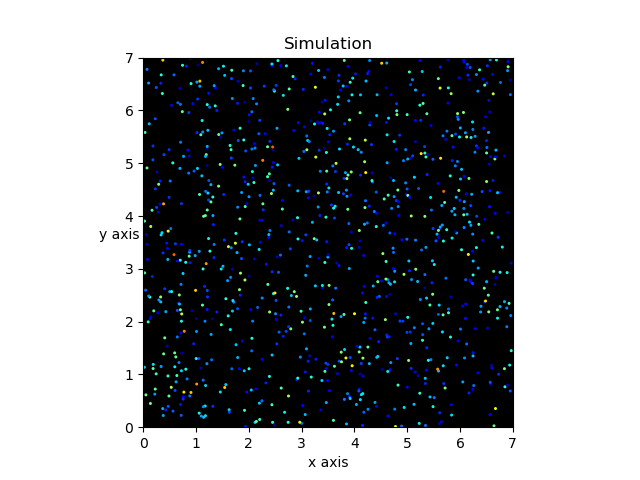
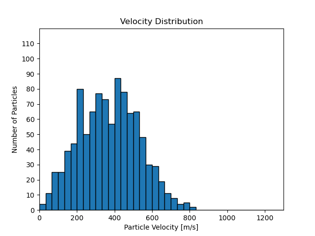
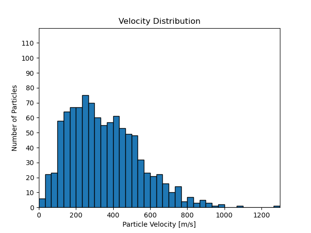
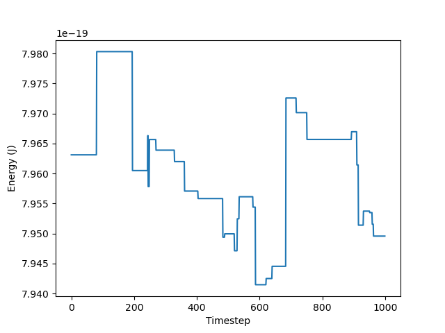

# Gas-Particle-Simulation

2D Simulation of gas particle collisions to visualise how the Maxwell Boltzmann distribution arises.

What does this simulation do:
1. Simulates and animates collisions of n particles
2. Animates a graph of the velocity distribution to show how it tends to the Maxwell Boltzmann distribution
3. Plots the total energy per time step for a check on energy conservation

Modules Used:
NumPy
Matplotlib
Itertools 

Physics Implementation:
Each particle is given an id at the start of the simulation to create particle pairs. At each time step the relative distance between the pairs are calculated and are checked for distances smaller than 2 radii, and if so the particles elastically collide. Each particle is also checked for boundary collisions in the same way where the respective velocity is reversed for this collision. 

Running the Simulation:

The simulation is split into 3 classes:
Particles - Stores the positions, velocities and updates both
Simulation - Implements collision physics and runs the simulation
Animation - Animates the results of the Simulation

To run the simulation you create a Simulation class object and call .simulate() with the respective parameters.
The simulation can be saved to an .npz file, or ran directly to then be animated
To animate you take the data and parameters from the simulation and input them into the Animation class object then call the respective animation methods for what you want to see (collision animation, velocity distribution animation or kinetic energy plot)

note that simulations of 1000+ particles may take a minute or so due to number of distances computed. (In the future I plan to change collision checking to only neighbouring particles)

Results for n = 1000, for 1000 time steps:
For the initial velocity the results show a standard looking normal distribution, where the histogram looks roughly symmetric about the centre of normal distribution.

The final velocity distribution differs as it is skewed to the left, with a long tail going down to the right of the plot. This is to be expected of the Maxwell Boltzmann Distribution. 

The Kinetic Energy over time does not vary much at all, having oscillating like behaviour about the centre.

Although this data suggests this simulation is successful as it resembles the correct distribution, ideally I would simulate more particles for longer. However, the computation time increases exponentially as the distance calculations scale with O(N^2) due to sorting ids for x and y positions. 

